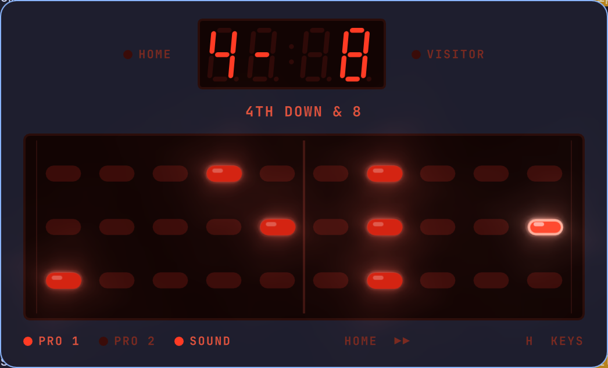

# LED Gridiron

A retro handheld LED football game for [Omarchy](https://omarchy.org/). Red blips on a three-lane
field, a 7-segment scoreboard, and piezo beeps, all running inside the Omarchy shell.



You are the bright blip. Dodge the defenders, throw to the blinking receiver, and kick when you
run out of downs. Home runs right, Visitor runs left. One player plays both offenses against the
computer defense, or two players pass the keyboard on each change of possession.

## Install

```bash
omarchy plugin add https://github.com/jameydavis/led-gridiron.git --enable
```

Click the football icon in the bar to play. To open it from a key, add a binding in
`~/.config/hypr/bindings.lua` that runs:

```bash
omarchy-shell jameydavis.led-gridiron toggle
```

## Keys

| Key | Button |
| --- | --- |
| `W` `A` `S` `D` (or arrows) | Move one step per press. The first move snaps the ball |
| `Space` | **Pass** to the blinking receiver, before you cross the line of scrimmage. Defenders past the line in its path pick it off |
| `E` | **Kick**. Before the snap: a field goal inside the opponent's 38, otherwise a punt. Also kicks the extra point |
| `Q` | **Status**: after the whistle, sets up the next play. Tap to cycle field position, down and distance, and time left once; hold to keep the readout cycling until you let go |
| `R` | **Score**: Home and Visitor. Tap for a quick look, hold to keep it up until you let go |
| `1` / `2` | **Pro 1**: zone defense (only the two closest defenders chase), and a defender who misses a tackle is knocked out of the play. **Pro 2**: the whole defense swarms. Switch between plays |
| `P` | Pause |
| `M` | Sound on/off |
| `N` `N` | New game (press twice) |
| `H` | Show or hide the key legend under the field |
| `Esc` | Close (a play in progress is paused) |

## Rules

- The field doesn't scroll. Run off the front edge of the display and it wraps to the next 10
  yards, with the defenders keeping their spots on the glass, until you reach the end zone. You
  can't back off the rear edge.
- After every play, press STATUS (`Q`) to reset the field for the next snap.
- Every kickoff return and every snap starts from the classic lineup: you on the first column, a three-man line three
  columns ahead, a linebacker in the middle, a defender up top and a deep back at the far end.
- Four 5:00 quarters. The clock runs during plays, and each tackle runs off 8 more seconds.
- Gain 10 yards in four downs for a first down, or the ball turns over at the spot.
- Touchdown 6, extra point 1, field goal 3, safety 2.
- At the snap the receiver lights up just behind the defensive line and runs a route. Any
  defender past the line of scrimmage on the straight path to the receiver intercepts the pass,
  but you can throw over defenders who have rushed up to the line or into your backfield. Cross
  the line yourself and the receiver goes dark: no more passing on that play.
- The opening kickoff goes to Home and the second-half kickoff to Visitor. After a score, the
  other team receives.

## Requirements

- Omarchy with the Quickshell-based `omarchy-shell`
- `pw-play` / `pw-cat` (PipeWire, standard on Omarchy) for sound. While the game is open, it holds
  a silent stream so the audio output doesn't fall asleep between plays and swallow beeps.

## Development

```bash
node test/logic.test.js        # rules engine tests, including fuzzed full games
python3 tools/gen_sounds.py    # rebuild sounds/*.wav from the synth recipes
omarchy plugin validate .
```

`Logic.js` holds the rules (plain JS, no QML). `BarWidget.qml` runs the timers, input, sound,
and device face. `Field.qml` draws the LED field and `SevenSeg.qml` draws the scoreboard digits.
Saving any file hot-reloads the plugin.

## Uninstall

```bash
omarchy plugin remove jameydavis.led-gridiron
```

## License

MIT. An original game inspired by the handheld LED sports games of the late 1970s. It is not
affiliated with or endorsed by any toy or game company.
